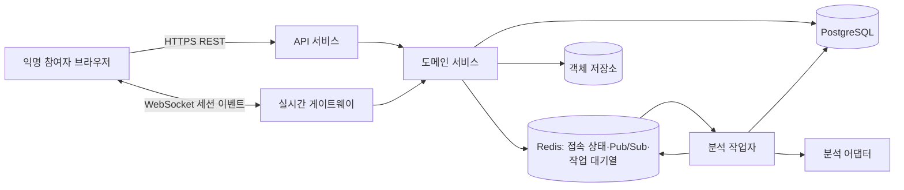

# BMPS 기술 설계

## Overview

### 개요

BMPS는 계정이나 개인 식별 정보를 요구하지 않는 참여자가 프로젝트별 세션에서 의견을 수집하고, 저장된 의견의 연계 및 방향성 제안을 검토하는 웹 협업 시스템이다. 이 설계는 `requirements.md`의 1.1부터 7.3까지를 대상으로 한다.

### 설계 범위와 전제

- 클라이언트와 서버는 TypeScript로 구현한다. 클라이언트는 React 기반 단일 페이지 애플리케이션, 서버는 HTTP API와 WebSocket 게이트웨이를 제공하는 서비스로 구성한다.
- 관계형 메타데이터는 PostgreSQL에, 파일 바이트는 S3 호환 클라우드 객체 저장소에 보관한다. Redis는 접속 인원 제한, 실시간 이벤트 전달, 분석 작업 대기열에 사용한다.
- 익명성은 계정 미생성이 아니라, 무작위 `participantId`를 담은 서명된 `HttpOnly`, `Secure`, `SameSite=Lax` 쿠키로 보장한다. 표시 이름은 선택 사항이며 개인 식별 정보를 수집하거나 로그에 기록하지 않는다.
- 세션 공개 설정은 요구사항의 접근 범위를 구현하기 위해 `PUBLIC`(목록/직접 URL로 참여 가능)과 `LINK_ONLY`(난수 초대 링크를 알아야 참여 가능)로 정의한다. 두 설정 모두 참여 정원, 파일 크기, 삭제 권한은 동일하다.
- “무료 세션 보존 기간”은 배포 환경 설정 `FREE_SESSION_RETENTION_DAYS`로 주입한다. 값이 확정되지 않았으므로 데이터베이스에는 계산된 만료 시각을 저장하고, 운영자가 제공 가능한 최대값을 설정한다.
- 분석 결과의 생성 방식은 특정 AI 공급자에 종속되지 않는다. 분석 서비스는 저장된 스냅샷을 입력으로 받아 구조화된 결과를 반환하는 교체 가능한 포트로 둔다. 분석 실패 시 원문 의견은 변경하지 않는다.

### 연구 결과와 설계 반영

- [MDN WebSocket API](https://developer.mozilla.org/en-US/docs/Web/API/WebSockets_API)는 브라우저와 서버의 양방향 상호작용 통신을 제공한다. 따라서 의견, 반응, 분석 상태 변경은 WebSocket 이벤트로 세션 참여자에게 전달하고, 재접속 시에는 HTTP 동기화 API로 누락분을 보충한다.
- [PostgreSQL 트랜잭션 격리 문서](https://www.postgresql.org/docs/current/transaction-iso.html)는 직렬화 가능한 실행이 동시 실행을 순차 실행과 동등하게 만든다고 설명한다. 전역 활성 세션 20개 및 세션별 참여자 20명 판정은 원자적 Redis 연산과 PostgreSQL 트랜잭션으로 보호한다.
- [OWASP 파일 업로드 지침](https://cheatsheetseries.owasp.org/cheatsheets/File_Upload_Cheat_Sheet.html)에 따라 파일 크기는 서버와 객체 저장소 정책에서 이중 검증하고, 원본 파일명 대신 서버 생성 객체 키를 사용하며, 파일을 애플리케이션 실행 경로 밖의 객체 저장소에 둔다.
- [MDN Content-Disposition 문서](https://developer.mozilla.org/en-US/docs/Web/HTTP/Reference/Headers/Content-Disposition)는 응답의 인라인 표시와 내려받기 처리를 구분한다. BMPS는 검증된 안전 미리보기 유형만 샌드박스된 뷰어와 `inline` 응답으로 제공하고, 나머지 및 브라우저가 표시하지 못하는 파일은 `attachment` 내려받기 URL로 제공한다.
- [fast-check 공식 문서](https://fast-check.dev/)는 TypeScript 테스트 러너와 함께 사용할 수 있고 실행 횟수를 설정할 수 있다. 아래의 순수 도메인 규칙에는 fast-check의 최소 100회 생성 테스트를 적용한다.

## Architecture

### 아키텍처

### 계층과 책임

1. **프레젠테이션 계층**: 세션, 의견, 분석 결과를 패널 조합으로 렌더링한다. REST 응답으로 초기 상태를 받고 WebSocket 이벤트를 적용한다. 신뢰할 수 없는 텍스트와 링크 설명은 HTML로 해석하지 않는다.
2. **전송 계층**: HTTP는 명령, 조회, 업로드 URL 발급, 재접속 동기화에 사용한다. WebSocket은 인증된 익명 주체의 세션 입장과 이벤트 수신에 사용한다. 모든 명령에는 UUID 형식 `idempotencyKey`를 넣어 재전송을 중복 처리하지 않는다.
3. **도메인 계층**: 세션 접근 정책, 정원, 입력 검증, 제출자/방장 삭제 권한, 분석 스냅샷 생성, 반응 연결, 패널 투영을 수행한다. 분석 모델, 객체 저장소, 메시지 브로커는 인터페이스 뒤에 둔다.
4. **영속성 계층**: PostgreSQL은 관계, 상태, 버전, 삭제 마커를 트랜잭션으로 기록한다. 객체 저장소는 파일 바이트만 보관한다. Redis TTL 기반 존재 정보는 동시 접속 수를 계산하지만 장기 보존 데이터의 원본은 아니다.
5. **비동기 작업 계층**: 분석과 삭제 재시도를 대기열에서 수행한다. 분석은 반드시 요청 순간에 확정한 스냅샷을 사용하며, 재분석은 새 스냅샷과 새 분석 결과를 만든다.

### 핵심 흐름

#### 세션 생성 및 참여

1. `POST /sessions`는 입력을 검증한 뒤 전역 `capacity_guard` 행을 잠그고 `activeSessionCount < 20`인지 확인한다. 통과하면 세션, 방장 멤버십, 초기 변경 이벤트를 하나의 트랜잭션으로 기록한다.
2. 참여 요청은 공개 설정을 판정하고, Redis의 세션별 참여자 집합에 `participantId`를 원자적으로 등록한다. 등록 뒤 인원이 20명을 넘으면 등록을 되돌리고 `SESSION_FULL`을 반환한다. 30초마다 heartbeat를 갱신하고 연결 종료 시 제거한다.
3. 입장 성공 응답은 세션의 현재 의견, 비삭제 반응, 분석 결과와 이후 동기화 기준 `cursor`를 반환한다. WebSocket은 동일 세션 채널만 구독한다.

#### 의견 및 파일 제출

1. 텍스트/링크 의견은 서버가 유형별 필수 값을 검증하고 의견 레코드와 변경 이벤트를 트랜잭션으로 생성한다. 링크는 `https` 또는 `http` URL만 수락한다.
2. 파일 의견은 `POST /uploads/initiate`에서 선언 크기 `<= 20 MiB`와 세션 권한을 검증한 뒤, 단일 객체 키와 크기 제한 조건이 든 짧은 수명의 업로드 URL을 발급한다.
3. `POST /uploads/{uploadId}/complete`는 객체의 실제 크기와 탐지한 MIME 유형을 재확인한 후 파일 메타데이터와 의견을 트랜잭션으로 저장한다. 객체가 없거나 초과 크기이면 메타데이터를 만들지 않고 객체를 삭제한다.
4. 미리보기 요청은 파일의 검증 MIME, 브라우저 지원 목록, 악성 콘텐츠 검사 상태를 기준으로 `preview` 또는 `download` 표현을 선택한다. 원본 파일명은 `Content-Disposition`의 안전하게 인코딩된 표시명에만 사용한다.

#### 분석, 확인 및 재분석

1. 분석 요청은 세션의 현재 비삭제 의견과 분석 가능한 반응을 읽어 정렬된 `analysis_snapshot`을 만든다. 스냅샷의 콘텐츠 해시와 의견/반응 버전을 함께 저장한 뒤 작업을 대기열에 넣는다.
2. 작업자는 스냅샷만 분석 어댑터에 전달한다. 결과에는 연결 후보별 의견 ID, 대화 흐름 요약, 방향성 후보, 확인 요청을 포함한다. 결과와 확인 요청을 같은 트랜잭션에서 저장하고 `analysis.completed` 이벤트를 발행한다.
3. 재분석은 사용자가 지정한 원본 분석 결과를 변경하지 않고 새 `analysis_result`와 새 스냅샷을 만든다. 스냅샷에는 요청 시점의 비삭제 세션 의견과 **지정한 원본 분석 결과에 연결되어 저장된 비삭제 반응만** 포함한다. 사용자가 수정한 분석 결과는 원본과 별도 식별자·내용으로 저장하고 `revisionOfAnalysisId`로 원본 계보에 연결한다.
4. 반응은 확인 요청과 분석 결과에 외래 키로 연결한다. 재분석 요청의 대상 분석 결과 ID는 필수이며, 다른 분석 결과의 반응은 분석 대상에서 제외한다.

#### 재접속과 다중 패널

클라이언트는 마지막 `cursor`를 저장한다. `GET /sessions/{sessionId}/changes?after={cursor}`는 그 이후 생성·수정·삭제된 의견, 분석 결과, 반응의 순서화된 변경 이벤트를 반환한다. 화면 구성은 세션 단위 사용자 환경설정으로 저장하며, 두 개 이상의 패널은 독립 데이터 구독을 가진 그리드 항목으로 동시 렌더링한다. 없는 데이터는 오류가 아닌 명시적 빈 상태로 표시한다.

## Components and Interfaces

### 구성 요소와 인터페이스

| 구성 요소 | 책임 | 주요 인터페이스 | 요구사항 |
|---|---|---|---|
| 익명 주체 서비스 | 쿠키 발급, 요청 주체 식별, 방장/업로더 권한 확인 | `resolvePrincipal()`, `assertCanDeleteItem()` | 1.1, 6.4, 6.5 |
| 세션 서비스 | 생성, 공개 설정 판정, 전역/세션 정원, 입장 상태 | `createSession`, `joinSession`, `leaveSession`, `getSessionState` | 1.1–1.3, 1.5–1.8, 7.1–7.3 |
| 존재 상태 서비스 | Redis 원자 집합과 heartbeat로 동시 접속 인원 관리 | `admit(sessionId, participantId)`, `heartbeat`, `remove` | 1.5, 1.6 |
| 의견 서비스 | 텍스트·링크·파일 의견의 검증, 생성, 삭제, 변경 이벤트 기록 | `createTextItem`, `createLinkItem`, `createFileItem`, `deleteItem` | 1.4, 1.7, 2.1–2.5, 6.1, 6.4, 6.5 |
| 파일 서비스 | 제한된 업로드 URL, 실제 파일 검증, 객체 저장·삭제, 미리보기/다운로드 표현 | `initiateUpload`, `completeUpload`, `getFilePresentation` | 2.3–2.8, 6.3–6.5 |
| 분석 서비스 | 고정 스냅샷, 지정한 원본 결과 기준 재분석, 수정 결과 계보·연계 후보 저장 | `requestAnalysis`, `reanalyse`, `reviseAnalysis` | 3.1–3.6, 4.4, 6.1 |
| 확인 서비스 | 확인 요청 생성과 반응 연결·조회, 재분석 대상 반응 범위 제공 | `createPrompts`, `submitReaction`, `listReviewContext` | 4.1–4.4 |
| 동기화 서비스 | 커서 기반 변경 목록과 WebSocket 이벤트 발행 | `listChanges`, `publishSessionEvent` | 1.4, 1.8, 6.2, 7.3 |
| 패널 워크스페이스 | 세션/의견/분석 패널 조합과 빈 상태 렌더링 | `addPanel`, `selectLayout`, `renderPanel` | 5.1–5.5 |

### HTTP 및 WebSocket 계약

| 목적 | 계약 | 성공 응답 또는 이벤트 |
|---|---|---|
| 세션 생성 | `POST /sessions {title, accessPolicy}` | `201 {session, hostMembership, cursor}` |
| 세션 참여 | `POST /sessions/{id}/join {accessToken?}` | `200 {session, items, analyses, reactions, cursor}` |
| 세션 초기/재접속 동기화 | `GET /sessions/{id}` / `GET /sessions/{id}/changes?after=cursor` | 상태 스냅샷 / 순서화된 `ChangeEvent[]` |
| 텍스트·링크 의견 | `POST /sessions/{id}/items` | `201 {item, cursor}` |
| 파일 업로드 | `POST /uploads/initiate`, 객체 PUT, `POST /uploads/{id}/complete` | 업로드 URL / `201 {item, file}` |
| 파일 열람 | `GET /files/{id}/presentation` | `200 {mode: preview|download, url}` |
| 의견 삭제 | `DELETE /sessions/{id}/items/{itemId}` | `204`, 이어서 `item.deleted` |
| 분석 생성·재분석·수정 | `POST /sessions/{id}/analyses`, `POST /analyses/{sourceAnalysisId}/reanalyse`, `PATCH /analyses/{id}` | `202 {analysisId, status}` 또는 원본과 구분된 수정 결과 |
| 반응 제출 | `POST /prompts/{id}/reactions` | `201 {reaction, cursor}` |
| 실시간 채널 | `WS /realtime`, `subscribe {sessionId, cursor}` | `item.created`, `item.deleted`, `analysis.completed`, `reaction.created`, `session.changed` |

모든 쓰기 요청은 인증된 익명 쿠키와 `Idempotency-Key` 헤더를 요구한다. API는 외부 입력을 스키마 검증한 뒤 처리하며, 오류 응답은 `{code, message, field?}` 형식을 사용한다.

## Data Models

### 데이터 모델

| 엔터티 | 핵심 필드 | 제약 및 관계 |
|---|---|---|
| `anonymous_principal` | `id`, `createdAt`, `lastSeenAt` | 식별 가능한 프로필 필드는 저장하지 않는다. 쿠키의 서명된 식별자가 `id`를 참조한다. |
| `session` | `id`, `title`, `accessPolicy`, `hostPrincipalId`, `status`, `retentionExpiresAt`, `contentVersion`, `createdAt` | `accessPolicy ∈ {PUBLIC, LINK_ONLY}`, `status ∈ {ACTIVE, CLOSED, EXPIRED}`. 방장은 익명 주체 하나다. |
| `session_access_token` | `id`, `sessionId`, `tokenHash`, `expiresAt`, `revokedAt` | `LINK_ONLY` 세션의 난수 접근 토큰 해시만 저장한다. |
| `session_membership` | `sessionId`, `principalId`, `role`, `joinedAt` | 역할은 `HOST` 또는 `PARTICIPANT`. 장기 참여 이력이며 실시간 인원수의 원본이 아니다. |
| `opinion_item` | `id`, `sessionId`, `authorPrincipalId`, `kind`, `text`, `linkUrl`, `description`, `status`, `createdAt`, `updatedAt`, `version` | `kind ∈ {TEXT, LINK, FILE}`. 유형에 맞는 값만 허용하며 `status=DELETED`는 일반 조회에서 제외한다. |
| `stored_file` | `id`, `itemId`, `objectKey`, `originalName`, `byteSize`, `declaredMimeType`, `detectedMimeType`, `scanStatus`, `createdAt`, `deletedAt` | `byteSize <= 20 * 1024 * 1024`; `objectKey`는 UUID 기반이며 공개 URL을 저장하지 않는다. 의견과 1:1이다. |
| `analysis_snapshot` | `id`, `sessionId`, `sourceContentVersion`, `sourceAnalysisId?`, `contentHash`, `createdAt` | 요청 시점 비삭제 의견, 그리고 재분석이면 `sourceAnalysisId`에 연결된 비삭제 반응과 각 버전을 불변 JSON으로 저장한다. 최초 분석에서는 `sourceAnalysisId`가 없다. |
| `analysis_result` | `id`, `sessionId`, `snapshotId`, `revisionOfAnalysisId`, `status`, `flowSummary`, `directionCandidates`, `createdAt`, `updatedAt` | 원본·재분석·수정 결과를 모두 별도 레코드로 유지한다. 수정 결과는 원본과 구분되는 자체 내용·생성 시각을 가지며 `revisionOfAnalysisId`로만 원본을 참조한다. |
| `analysis_link_candidate` | `id`, `analysisId`, `rationale`, `confidence` | 연결된 의견은 조인 테이블 `link_candidate_item(candidateId, itemId)`로 식별한다. |
| `confirmation_prompt` | `id`, `analysisId`, `question`, `options`, `createdAt` | 분석 결과 생성 시 하나 이상 생성한다. |
| `reaction` | `id`, `promptId`, `analysisId`, `authorPrincipalId`, `selectedOption`, `text`, `createdAt`, `version` | `prompt.analysisId = analysisId`를 강제하고, 텍스트 또는 허용 선택값을 요구한다. |
| `change_event` | `cursor`, `sessionId`, `entityType`, `entityId`, `operation`, `entityVersion`, `occurredAt` | 세션별 단조 증가 커서. 재접속 동기화와 실시간 순서 보장의 기준이다. |
| `idempotency_record` | `principalId`, `key`, `requestHash`, `responseRef`, `expiresAt` | 같은 주체·키의 동일 명령은 최초 결과를 재사용하고, 다른 본문이면 충돌로 거부한다. |

### 무결성 규칙과 인덱스

- `session(status='ACTIVE')`의 생성은 전역 `capacity_guard` 단일 행을 `SELECT … FOR UPDATE`로 잠가 20개 미만일 때만 허용한다. 세션 상태 변경도 같은 잠금을 사용한다.
- 세션별 동시 접속 수는 Redis 스크립트가 주체별 중복 접속을 하나로 계산하면서 원자적으로 20명 미만을 확인한다. Redis 장애 시 새 입장은 보수적으로 거부하고 기존 HTTP 조회는 허용한다.
- 모든 세션 종속 테이블은 `sessionId` 외래 키와 `(sessionId, createdAt, id)` 인덱스를 둔다. `change_event`에는 `(sessionId, cursor)` 고유 인덱스를 둔다.
- 의견 삭제는 권한 확인과 `status=DELETED`, 삭제 이벤트 기록을 하나의 트랜잭션으로 완료한다. 파일 객체 삭제가 실패하면 파일은 접근 불가 상태를 유지하고 재시도 작업이 완료할 때까지 감사 경보를 낸다.
- 분석 스냅샷과 결과는 원본 의견이 삭제되어도 분석의 역사적 근거를 유지하되, 삭제된 원문 파일 URL은 절대 노출하지 않는다. 재분석 스냅샷의 `sourceAnalysisId`는 요청 대상 분석 결과를 참조하며, 반응 선택은 그 결과 ID와 일치하는 `reaction.analysisId`로 제한한다.
- 의견 삭제는 요청 주체가 작성자이거나 세션 방장일 때만 실행한다. 세션 방장은 다른 작성자의 의견도 별도 동의·승인 절차 없이 즉시 삭제할 수 있으며, 그 외 주체의 요청은 상태와 파일 접근성을 바꾸지 않는다.

## Correctness Properties

### 정확성 속성

*속성(property)은 모든 유효한 실행에서 유지되어야 하는 시스템 특성 또는 동작이다. 즉 시스템이 해야 할 일을 기계적으로 검증할 수 있게 표현한 문장으로, 사람이 읽는 요구사항과 자동화된 정확성 보장 사이를 연결한다.*

속성 기반 테스트(PBT)는 이 설계의 순수 도메인 규칙, 스냅샷 생성, 권한 판정, 커서 동기화에 적용한다. 브라우저 렌더링, 객체 저장소 동작, 실제 WebSocket 연결은 외부 의존성 또는 UI이므로 이 절의 속성 대신 예제·통합 테스트로 검증한다.

### Property 1: 세션 생성의 방장과 공개 설정 보존

For all 유효한 세션 생성 명령과 익명 주체 및 공개 설정에 대해, 세션을 생성하면 생성된 세션의 방장은 요청 주체이고 저장된 공개 설정은 요청한 값과 같아야 한다.

**Validates: Requirements 1.1, 1.2**

### Property 2: 접근 정책 판정과 입장 상태 투영

For all 세션 접근 정책, 유효·무효 접근 토큰, 그리고 비삭제 의견과 반응 집합에 대해, 참여가 허용되는 경우에만 입장 상태는 해당 세션의 현재 의견과 반응을 모두 포함하고, 허용되지 않는 경우 상태를 노출하지 않아야 한다.

**Validates: Requirements 1.3**

### Property 3: 의견 제출의 저장 및 세션 내 이벤트 전달

For all 유효한 의견과 활성 세션에 대해, 의견을 제출하면 그 의견은 해당 세션에 한 번 저장되고 같은 세션을 구독한 참여자에게만 생성 이벤트로 전달되어야 한다.

**Validates: Requirements 1.4**

### Property 4: 세션별 참여 정원

For all 고유 익명 참여자 집합이 0명부터 20명인 활성 세션에 대해, 새 고유 참여자의 입장은 기존 인원이 20명 미만일 때만 수락되어 수가 하나 증가하고, 20명일 때는 `SESSION_FULL`로 거부되어 집합이 변하지 않아야 한다.

**Validates: Requirements 1.5, 1.6**

### Property 5: 유효하지 않은 명령의 상태 불변성

For all 필수 필드 누락, 빈 값, 잘못된 식별자·URL·선택값을 가진 세션 생성·참여·의견·반응 명령에 대해, 명령은 입력 오류를 반환하고 영속 상태나 변경 이벤트를 만들지 않아야 한다.

**Validates: Requirements 1.7**

### Property 6: 세션 전환과 데이터 격리

For all 둘 이상의 세션과 각 세션에 귀속된 의견, 분석 결과, 반응에 대해, 한 세션으로 전환하거나 조회하면 대상 세션의 데이터만 표시되고 다른 세션을 포함한 모든 저장 데이터는 변하지 않아야 한다.

**Validates: Requirements 1.8, 7.3**

### Property 7: 텍스트·링크 의견의 유형별 보존

For all 비어 있지 않은 텍스트 또는 유효한 HTTP(S) URL과 설명에 대해, 의견을 생성한 뒤 조회한 값은 원래 세션·작성자·유형·내용을 보존해야 하며, 텍스트 의견에는 URL이, 링크 의견에는 텍스트 본문이 잘못 채워지지 않아야 한다.

**Validates: Requirements 2.1, 2.2**

### Property 8: 파일 크기 경계의 원자적 처리

For all 실제 파일 크기와 파일 설명에 대해, 크기가 20 MiB 이하이면 파일 메타데이터와 FILE 의견이 함께 생성되어야 하며, 20 MiB를 초과하면 `FILE_TOO_LARGE` 오류를 반환하고 둘 중 어느 것도 생성하지 않아야 한다.

**Validates: Requirements 2.3, 2.4**

### Property 9: 분석 스냅샷의 요청 시점 완전성

For all 기존 및 새 비삭제 의견을 가진 세션과 분석 요청 시점 이후의 변경에 대해, 생성된 분석 스냅샷은 요청 시점의 모든 비삭제 의견과 해당 버전을 포함하고 이후 변경은 포함하지 않아야 한다.

**Validates: Requirements 3.1, 6.1**

### Property 10: 분석 결과의 필수 구조 보존

For all 유효한 분석 어댑터 결과에 대해, 저장·표시되는 분석 결과는 하나 이상의 연계 후보, 대화 흐름 요약, 방향성 후보 필드를 포함해야 한다.

**Validates: Requirements 3.2**

### Property 11: 분석 결과의 스냅샷 근거 표시

For all 분석 결과와 그 결과의 분석 스냅샷에 대해, 분석 결과 조회는 결과 자체와 정확히 그 스냅샷에서 사용한 의견 항목을 함께 반환해야 한다.

**Validates: Requirements 3.3**

### Property 12: 연계 후보의 의견 식별 완전성

For all 분석 결과의 연계 후보와 후보별 의견 ID 집합에 대해, 후보 표시 모델은 각 후보에 연결된 모든 의견 항목 ID를 포함하고 다른 후보의 의견 ID를 포함하지 않아야 한다.

**Validates: Requirements 3.4**

### Property 13: 지정 결과 기반 재분석의 계보와 반응 스냅샷

For all 원본 분석 결과, 요청 시점의 비삭제 세션 의견, 그리고 여러 분석 결과에 연결된 반응에 대해, 지정한 원본 결과의 재분석은 원본과 다른 분석 ID 및 스냅샷 ID를 만들고 새 스냅샷에는 요청 시점 의견과 **그 원본 결과에 연결된 비삭제 반응만** 포함해야 하며 다른 결과의 반응은 포함하지 않아야 한다.

**Validates: Requirements 3.5, 4.4**

### Property 14: 분석 수정 결과의 구분 저장과 원본 불변성

For all 원본 분석 결과와 유효한 수정 내용에 대해, 수정 요청은 원본과 다른 결과 ID·내용·생성 시각을 가진 새 분석 결과를 저장하고 그 결과의 `revisionOfAnalysisId`를 원본 ID로 설정해야 하며, 원본 결과의 내용과 식별자를 변경하지 않아야 한다.

**Validates: Requirements 3.6**

### Property 15: 분석 완료 시 확인 요청 생성

For all 성공적으로 저장된 분석 결과에 대해, 같은 분석 ID에 연결된 확인 요청이 하나 이상 생성되어 참여자 표시 모델에 포함되어야 한다.

**Validates: Requirements 4.1**

### Property 16: 반응의 확인 요청 및 분석 결과 연결

For all 유효한 확인 요청과 텍스트 또는 허용 선택값 반응에 대해, 저장된 반응은 해당 확인 요청 ID와 그 확인 요청이 속한 분석 결과 ID를 모두 참조해야 한다.

**Validates: Requirements 4.2**

### Property 17: 분석 검토 문맥의 관계 격리

For all 여러 분석 결과에 속한 확인 요청과 반응에 대해, 특정 분석 결과의 검토 문맥 조회는 그 결과에 연결된 확인 요청과 반응을 모두 포함하고 다른 분석 결과의 것은 포함하지 않아야 한다.

**Validates: Requirements 4.3**

### Property 18: 다중 패널 구성의 보존

For all 서로 다른 두 개 이상의 패널 정의로 구성된 워크스페이스에 대해, 패널을 추가한 뒤의 상태와 렌더 모델은 모든 패널을 한 번씩 포함하여 동시에 표시해야 한다.

**Validates: Requirements 5.4**

### Property 19: 커서 기반 재접속 동기화의 완전성

For all 순서화된 세션 변경 이벤트와 유효한 마지막 커서에 대해, 재접속 동기화는 그 커서보다 뒤의 추가·수정·삭제 이벤트를 정확한 순서로 모두 반환하고 그 이전 이벤트는 반환하지 않아야 한다.

**Validates: Requirements 6.2**

### Property 20: 작성자·방장 삭제 권한과 즉시 접근 차단

For all 파일 유무가 다른 의견, 작성자, 세션 방장, 그리고 작성자도 방장도 아닌 주체에 대해, 작성자와 세션 방장은 의견 삭제를 성공시켜 의견과 연결 파일을 일반 조회·열람에서 제외할 수 있어야 하며, 특히 세션 방장은 다른 작성자의 의견도 그 작성자의 동의 없이 즉시 삭제할 수 있어야 하고, 그 외 주체의 요청은 상태를 변경하지 않아야 한다.

**Validates: Requirements 6.4, 6.5**

### Property 21: 전역 활성 세션 정원

For all 0개부터 20개의 활성 세션 집합에 대해, 새 세션 생성은 활성 수가 20개 미만일 때만 성공하여 수를 하나 증가시키고 20개일 때는 `ACTIVE_SESSION_CAPACITY_REACHED`로 거부되어야 한다.

**Validates: Requirements 7.1, 7.2**

## Error Handling

### 오류 처리

| 조건 | 오류 코드 및 HTTP 상태 | 클라이언트 처리 | 상태 보장 |
|---|---|---|---|
| 형식 오류·필수값 누락 | `VALIDATION_ERROR` / 400 | 필드별 오류와 수정 방법 표시 | 영속·이벤트·대기열 작업을 만들지 않는다. |
| 세션 없음·만료·종료 | `SESSION_NOT_AVAILABLE` / 404 또는 410 | 세션이 이용 불가함을 표시하고 구독 해제 | 다른 세션 데이터는 노출하지 않는다. |
| 링크 전용 토큰 누락·불일치 | `SESSION_ACCESS_DENIED` / 403 | 접근 링크 확인 안내 표시 | 상태 스냅샷을 반환하지 않는다. |
| 세션 참여자 20명 | `SESSION_FULL` / 409 | 정원 초과 안내와 재시도 선택지 표시 | Redis 등록을 되돌린다. |
| 활성 세션 20개 | `ACTIVE_SESSION_CAPACITY_REACHED` / 409 | 생성 불가 안내 표시 | 세션·방장 멤버십을 만들지 않는다. |
| 파일 크기 초과·실제 크기 불일치 | `FILE_TOO_LARGE` / 413, `UPLOAD_VERIFICATION_FAILED` / 422 | 20 MB 이하 파일 선택 안내 표시 | 파일 메타데이터와 의견을 만들지 않고 임시 객체를 삭제한다. |
| 허용하지 않는 URL 체계 | `INVALID_LINK_URL` / 400 | HTTP(S) 주소만 입력하도록 안내 | 링크를 저장하거나 자동 요청하지 않는다. |
| 파일 검사 미완료·위험 판정 | `FILE_NOT_AVAILABLE` / 423 | 미리보기/다운로드가 준비되지 않았음을 표시 | 파일 바이트를 노출하지 않는다. |
| 삭제 권한 없음 | `ITEM_DELETE_FORBIDDEN` / 403 | 권한 없음 표시 | 작성자와 세션 방장이 아닌 요청은 의견, 파일, 이벤트를 변경하지 않는다. |
| 분석 입력 없음·작업 실패 | `ANALYSIS_INPUT_EMPTY` / 422, `ANALYSIS_FAILED` / 502 | 분석 가능한 의견 제출 또는 재시도 안내 | 기존 의견·기존 분석 결과를 변경하지 않고 실패 상태와 제한된 오류 ID만 기록한다. |
| 경쟁 갱신·직렬화 충돌 | `CONFLICT_RETRY` / 409 또는 503 | 동일 `Idempotency-Key`로 안전하게 재시도 | 트랜잭션을 롤백하고 중복 기록을 만들지 않는다. |
| 대기열·Redis 장애 | `REALTIME_TEMPORARILY_UNAVAILABLE` / 503 | 읽기 전용 조회를 유지하고 지수 백오프 재연결 | 새 입장은 보수적으로 거부하고, 쓰기 이벤트는 DB 트랜잭션 후 outbox에서 재발행한다. |

서버 로그에는 오류 코드, 요청 상관 ID, 세션 ID의 단방향 해시만 남긴다. 원문 의견, 링크의 쿼리 문자열, 파일명, 쿠키·접근 토큰은 로그·분석 오류·클라이언트 오류 화면에 넣지 않는다.

## Testing Strategy

### 테스트 전략

### 테스트 계층

- **단위 테스트**: Zod 등의 스키마 검증, URL 정규화, 권한 판정의 대표 예시, 파일 표현 분기, 빈 상태, 패널 렌더링을 목과 고정 시계로 검증한다.
- **속성 기반 테스트**: Vitest와 `fast-check`를 사용한다. 위 속성 1~21은 각각 정확히 하나의 속성 테스트로 구현하고 최소 100회(`numRuns: 100`) 실행한다. 각 테스트에는 다음 형식의 주석을 둔다. `Feature: bmps, Property N: [속성 본문]`.
- **통합 테스트**: 테스트 PostgreSQL, Redis, S3 호환 객체 저장소, 실제 HTTP/WebSocket 서버를 컨테이너로 띄운다. 세션 정원 경쟁 요청, 업로드 완료와 객체 존재, 다운로드 헤더, 보존 기간 만료, outbox 재전달을 검증한다.
- **브라우저 E2E 테스트**: 두 개 이상의 독립 브라우저 컨텍스트로 실시간 의견 반영, 세션 전환, 재접속 변경 표시, 다중 패널, 파일 미리보기/다운로드, 분석 및 반응 흐름을 확인한다.
- **보안 테스트**: `javascript:`/`data:` 링크 거부, XSS 문자열 이스케이프, 위조된 업로드 완료 요청, 20 MiB 경계, 서명 URL 만료, 타인 삭제 시도를 확인한다.

### 요구사항별 예제·통합 검증

| 대상 기준 | 테스트 종류 | 대표 시나리오 |
|---|---|---|
| 2.5 | 통합 | 테스트 객체 저장소에 파일 의견을 완료하고 DB의 `objectKey`와 실제 객체 존재를 함께 확인한다. |
| 2.6 | 단위/E2E | HTTPS 링크 카드를 선택하면 안전한 새 창 링크 또는 열람 화면이 올바른 URL을 사용한다. |
| 2.7 | 단위/E2E | PDF 또는 이미지 MIME은 `preview` 표현과 샌드박스된 열람 UI를 제공한다. |
| 2.8 | 단위/통합 | 미지원 이진 파일은 `download` 표현과 `Content-Disposition: attachment` 응답을 제공한다. |
| 5.1 | 컴포넌트 | 세션 패널이 해당 세션의 의견과 분석 결과를 함께 표시한다. |
| 5.2 | 컴포넌트 | 의견 패널이 선택 의견의 연계 후보와 반응만 표시한다. |
| 5.3 | 컴포넌트 | 분석 패널이 분석 결과와 스냅샷 의견 목록을 표시한다. |
| 5.5 | 컴포넌트 | 의견·분석·반응이 없는 세션의 각 패널이 빈 상태를 표시하고 오류 없이 렌더링한다. |
| 6.3 | 시간 제어 통합 | 짧은 테스트 보존 기간에서 만료 전 파일 접근 가능과 만료 후 객체·메타데이터 정리를 확인한다. |

### 동시성과 관찰 가능성

- 참여자 21명이 동시에 입장하는 통합 시험에서 성공 응답은 정확히 20개여야 한다. 활성 세션을 동시에 21개 생성하는 시험도 정확히 20개만 성공해야 한다.
- Redis heartbeat 만료, WebSocket 연결 단절, 재접속을 시뮬레이션해 유령 접속자가 정원을 영구 점유하지 않는지 확인한다.
- 분석 요청 이후 의견을 추가·삭제해도 기존 분석 스냅샷과 결과가 변하지 않고, 특정 원본 분석 결과를 지정한 재분석에는 그 결과에 연결된 반응만 포함되는지 확인한다. 분석 결과 수정은 원본을 바꾸지 않고 구분된 계보 레코드를 생성하는지도 확인한다.
- 세션 방장이 다른 작성자의 파일 포함 의견을 삭제하는 통합 시험에서 작성자 동의 없이 즉시 삭제 이벤트가 발생하고 의견·파일 접근이 차단되는지 확인한다.
- 운영 지표는 활성 세션 수, 세션별 접속 인원, 업로드 거부 수, 분석 대기 시간·실패율, 동기화 지연, 객체 삭제 재시도 수를 익명 집계로 기록한다.

## 요구사항 추적성

각 수용 기준은 아래의 설계 위치와 테스트 방법으로 추적한다. `P#`는 위 정확성 속성 번호다.

| 기준 | 설계 반영 | 검증 |
|---|---|---|
| 1.1 | 세션 서비스, `session.hostPrincipalId`, 세션 생성 흐름 | P1 |
| 1.2 | `accessPolicy`, 세션 생성 흐름 | P1 |
| 1.3 | 세션 서비스의 접근 정책 판정과 입장 응답 | P2 |
| 1.4 | 의견 서비스, WebSocket `item.created` | P3 |
| 1.5 | 존재 상태 서비스의 원자적 입장 | P4 |
| 1.6 | 존재 상태 서비스의 `SESSION_FULL` 분기 | P4 |
| 1.7 | 공통 스키마 검증과 오류 처리 | P5 |
| 1.8 | 커서 동기화와 세션 전환 | P6 |
| 2.1 | `opinion_item.kind=TEXT`, 의견 서비스 | P7 |
| 2.2 | `opinion_item.kind=LINK`, URL 검증 | P7 |
| 2.3 | 파일 업로드 완료, `stored_file.byteSize` | P8 |
| 2.4 | 업로드 초기화·완료의 크기 이중 검증 | P8 |
| 2.5 | 객체 저장소와 `stored_file.objectKey` | 통합 테스트 |
| 2.6 | 링크 카드의 안전한 열람 제어 | 단위/E2E 테스트 |
| 2.7 | 파일 표현 API와 샌드박스 미리보기 | 단위/E2E 테스트 |
| 2.8 | 파일 표현 API의 내려받기 분기 | 단위/통합 테스트 |
| 3.1 | 불변 `analysis_snapshot` 생성 | P9 |
| 3.2 | 분석 어댑터 결과 계약 | P10 |
| 3.3 | 분석 결과·스냅샷 의견 조회 | P11 |
| 3.4 | `link_candidate_item` 조인 | P12 |
| 3.5 | 지정 원본 결과의 새 결과·스냅샷과 반응 범위 | P13 |
| 3.6 | 원본과 구분된 수정 결과 및 `revisionOfAnalysisId` 계보 | P14 |
| 4.1 | 분석 완료 트랜잭션의 `confirmation_prompt` | P15 |
| 4.2 | `reaction.promptId`, `reaction.analysisId` | P16 |
| 4.3 | 분석 검토 문맥 조회 | P17 |
| 4.4 | 지정 원본 결과 ID 기준 재분석 반응 스냅샷 | P13 |
| 5.1 | 세션 패널 | 컴포넌트 테스트 |
| 5.2 | 의견 패널 | 컴포넌트 테스트 |
| 5.3 | 분석 패널 | 컴포넌트 테스트 |
| 5.4 | 워크스페이스 패널 상태 | P18 |
| 5.5 | 빈 상태 컴포넌트 | 컴포넌트 테스트 |
| 6.1 | 분석 스냅샷의 전체 의견 선택 | P9 |
| 6.2 | `change_event` 및 after-cursor API | P19 |
| 6.3 | `retentionExpiresAt`와 객체 수명 작업 | 시간 제어 통합 테스트 |
| 6.4 | 작성자·방장 삭제 권한, 논리 삭제, 객체 삭제 작업 | P20 및 통합 테스트 |
| 6.5 | 방장의 타인 의견 즉시 삭제, 동의 불요 | P20 및 통합 테스트 |
| 7.1 | `capacity_guard` 잠금 | P21 |
| 7.2 | 전역 정원 초과 오류 | P21 |
| 7.3 | 세션 ID 외래 키와 조회 범위 | P6 |

### 미결 결정

- 무료 세션의 실제 최대 보존 일수는 운영 환경의 저장소 비용 및 규정에 따라 정해야 한다. 정해질 때까지 `FREE_SESSION_RETENTION_DAYS`를 배포 필수 설정으로 두며, 값이 없으면 서비스 시작을 실패시킨다.
- `LINK_ONLY` 링크의 만료 기간과 방장이 링크를 교체할 수 있는지 여부는 요구사항에 정의되어 있지 않다. 기본 설계는 만료 없는 난수 링크이며, 보안 정책이 필요하면 만료·폐기 UI와 요구사항을 추가해야 한다.
- 분석 어댑터의 모델, 비용 한도, 결과의 사람이 읽는 품질 기준은 제품 정책이 필요하다. 이 설계는 구조·스냅샷·계보만 보장하고 내용의 사실성은 별도 평가 기준으로 다룬다.

## 출처

- [MDN WebSocket API](https://developer.mozilla.org/en-US/docs/Web/API/WebSockets_API)
- [PostgreSQL Transaction Isolation](https://www.postgresql.org/docs/current/transaction-iso.html)
- [OWASP File Upload Cheat Sheet](https://cheatsheetseries.owasp.org/cheatsheets/File_Upload_Cheat_Sheet.html)
- [MDN Content-Disposition](https://developer.mozilla.org/en-US/docs/Web/HTTP/Reference/Headers/Content-Disposition)
- [fast-check 공식 문서](https://fast-check.dev/)

외부 문서의 내용은 라이선스 준수를 위해 요약·재서술했다.
