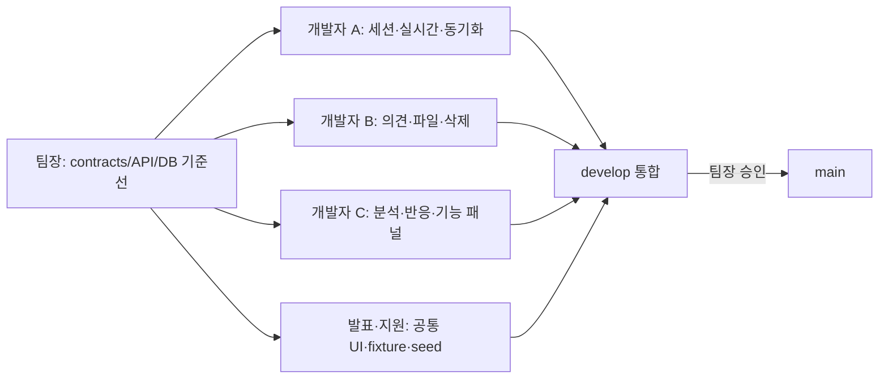

# BMPS 5인 협업 흐름

## 작업 연결의 기준

작업은 다음 네 요소로 연결합니다.

1. `.kiro/specs/bmps/tasks.md`의 작업 ID
2. GitHub Issue의 같은 작업 ID
3. 작업 ID를 포함한 기능 브랜치
4. 해당 Issue를 닫는 Pull Request

예시:

```text
Task 4.4
  → Issue: [4.4] 파일 업로드 완료 처리
  → Branch: feature/4.4-file-upload
  → PR: [4.4] 파일 업로드 완료 처리
  → develop 병합
```

## 기능 간 연결 지점

기능 담당자는 서로의 내부 코드를 직접 참조하지 않습니다. 모든 기능 연결은 `packages/contracts`의 공개 계약을 사용합니다.



## 역할별 전달물

### 팀장

- 공통 API·이벤트·DB 계약 기준선
- 계약 변경 승인과 병합 순서
- `develop` 통합과 릴리스 후보 판정
- 교차 기능 오류의 담당자 결정

### 개발자 A

- 세션 생성·입장 API와 익명 주체
- WebSocket 및 접속 인원 제한
- 재접속 변경 동기화
- 세션 보존 만료

개발자 B에게 `sessionId`, 권한 문맥과 세션 이벤트 발행 포트를 제공합니다. 개발자 C에게 세션 구독과 변경 커서 계약을 제공합니다.

### 개발자 B

- 텍스트·링크·파일 의견 API
- 객체 저장소와 파일 표시 방식
- 의견·파일 삭제

개발자 C에게 분석 입력용 의견 조회 포트를 제공합니다. 발표·지원 담당에게 링크·파일 표시 계약을 제공합니다.

### 개발자 C

- 분석 스냅샷과 결과
- 재분석 계보, 확인 요청과 반응
- 세션·의견·분석 패널의 데이터 컨트롤러

발표·지원 담당이 만든 패널 셸에 기능별 데이터를 연결합니다.

### 발표·지원 담당

전반부에는 공통 오류·빈 상태 UI, 패널 셸, 파일 열람 UI, fixture·mock과 데모 seed를 구현합니다. 기능 통합 준비 이후에는 검증된 화면과 seed를 사용해 PPT·발표·시연 자료를 준비합니다.

## 통합 순서

1. **기준선 준비:** 팀장이 프로젝트 구조, 계약, DB 관계를 제안합니다.
2. **계약 검토:** A·B·C가 각 소비 관점, 발표·지원 담당이 UI/mock 관점에서 검토합니다.
3. **계약 동결:** 팀장이 기준 버전을 승인하고 `develop`에 병합합니다.
4. **병렬 구현:** A·B·C·발표지원 담당이 동결 계약과 mock으로 독립 개발합니다.
5. **수직 슬라이스:** 세션 → 의견 → 분석 경로를 `develop`에서 처음 연결합니다.
6. **부가기능 통합:** 재접속, 삭제, 패널, 데모 seed를 연결합니다.
7. **릴리스 후보:** 실제 의존성 통합과 E2E 검증 후 팀장이 `main`에 병합합니다.

## 충돌 처리

- 계약 충돌: 팀장이 요구사항과 설계를 기준으로 결정합니다.
- 같은 파일 충돌: 파일 소유자가 해결하고 상대 담당자가 확인합니다.
- 기능 간 결함: 입력을 만든 기능이 아니라 계약을 위반한 기능이 수정합니다.
- 일정 지연: 내부 구현을 대신 가져오지 않고 계약 mock으로 다음 작업을 진행합니다.

## 팀 시작 전에 채울 값

- GitHub 저장소 URL
- 팀원별 GitHub 사용자명
- 개발자 A/B/C의 실제 이름
- 발표·지원 담당의 실제 이름
- `main`, `develop` 브랜치 보호 규칙
- 필수 CI 검사 이름
